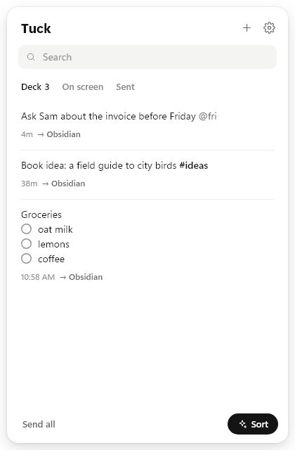
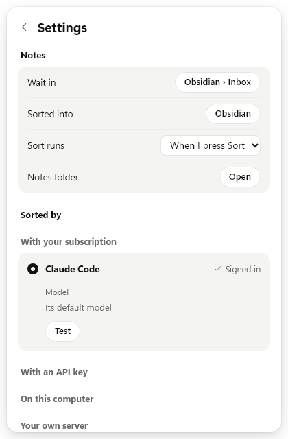

# Tuck

Tuck is a small Windows tray app for quick notes. Press a key, type the thought, press Enter, and you're back where you were. Your notes wait in a folder as plain Markdown files until you sort them, by hand or with the AI model you already use.

<p>
  
  
</p>

It's free and MIT licensed. Windows 10 and 11 only.

## Install

Download `Tuck_0.1.0_x64-setup.exe` from the [latest release](https://github.com/sa1ntsinner/tuck/releases/latest) and run it. It installs for your user account only and doesn't ask for admin rights.

**Windows SmartScreen will warn you.** The installer isn't code-signed, because a signing certificate costs a few hundred euros a year and Tuck makes no money. Windows shows "Windows protected your PC" for any unsigned program it hasn't seen often. Click **More info**, then **Run anyway**. If you'd rather not trust a binary, build it yourself (see below); the release is built by the GitHub Actions workflow in this repo, from the tagged commit.

On first launch Tuck walks you through four short screens: the keys, where notes wait, who sorts them, and whether it starts with Windows. It turns on start-with-Windows by default; switch it off on the last screen or in Settings.

To uninstall, use Windows Settings → Apps. Your notes stay in their folder.

## Shortcuts

| Key | What it does |
| --- | --- |
| Alt+Q | New note |
| Alt+W | New sticky note on the screen |
| Alt+Shift+Q | Open the deck (all notes) |
| Hold the middle mouse button | New note at the pointer |

You can change the three keys in Settings. The middle-button hold takes about a third of a second; a normal middle click still works. It stays off near the screen edges, in full-screen apps, and in CAD and 3D apps like Blender and SolidWorks (the list is in Settings).

Inside a note:

- Enter tucks the note away, Shift+Enter starts a new line
- Ctrl+Enter sends it straight to your default place
- Ctrl+P turns it into a sticky, Ctrl+Shift+P sticks it onto the app you came from
- Hold Ctrl to see the keys
- `@15:00`, `@20m`, `@tomorrow 9` or `@fri` sets a reminder
- `#tag` can route the note to a place you picked for that tag

Stickies can float on top, sit on the desktop under your windows, or follow one app and show only while it's in front. Ctrl+wheel zooms a sticky.

## Where notes live

Each note is one Markdown file named after its first words, like `2026-11-10 14.02 Ask Sam about the invoice.md`. By default they go to `Documents\Tuck`. You can point Tuck at a folder inside your Obsidian vault instead, so the inbox shows up there. Sent notes move to `.tuck\sent` and deleted ones to `.tuck\trash` inside that folder; Obsidian hides dot folders.

If the inbox folder disappears (you renamed or moved it), Tuck doesn't recreate it. It tells you and waits for you to pick the new place.

Settings live in `%APPDATA%\Tuck\settings.json`. API keys and app tokens in that file are encrypted with Windows DPAPI, so they're useless on another account or PC.

## Sort

Sort files your waiting notes into your notes library, usually an Obsidian vault. You press Sort (or let it run every hour or once each evening after 20:00), Tuck asks a model where each note belongs, shows you the plan grouped by place, and writes it when you agree. Scheduled sorts write without asking and show a notice afterwards.

The model only suggests. Tuck does the writing and checks every path first:

- the file must be a `.md` file inside the library
- its folder must already exist; Tuck never creates folders in your library
- no dot folders (`.obsidian`, `.git`), no `..`, no absolute paths, no names Windows reserves
- Tuck only appends to a file (under a heading if the model names one) or creates a new file next to existing ones; it never overwrites, deletes or reorders what's there

Notes the model isn't sure about stay in the inbox. Stickies on the screen are never sorted.

### What Sort sends, and to whom

One request goes to the provider you picked, and nowhere else. It contains:

- the waiting notes: their text, when you wrote them, and the app name and window title they were written in
- your library's own rules for agents, if it has them: the first 12,000 characters of `AGENTS.md`, `CLAUDE.md` or `README.md` at the library root
- a map of the library: folder names and up to 700 file names (big folders show only their newest files; attachments, templates and archive folders aren't opened)
- today's date and the path of today's daily note, from Obsidian's daily-notes settings

It doesn't send the contents of your other notes.

Providers you can pick:

- **Your subscription**, through a command-line agent you're already signed in to: Claude Code, Codex or Gemini CLI. Tuck runs it once per sort with no tools (Claude Code), or in a read-only sandbox (Codex), in a temp folder, and reads the answer. No API key needed.
- **An API key**: Anthropic, OpenAI, Google Gemini, OpenRouter (key or browser sign-in), Mistral, Groq, DeepSeek, xAI.
- **On this computer**: Ollama or LM Studio. Nothing leaves your PC.
- **Your own server**: anything that speaks the OpenAI chat-completions format.

What happens to the request after that is up to the provider and your account with them.

## Sending a note somewhere by hand

Settings → Send by hand to → Connect an app. Tuck finds what's on your PC first.

- Obsidian vaults and Logseq graphs: one click. Notes go to today's daily note or journal page, an inbox file, or a new note per card.
- Any Markdown folder.
- Joplin (click Allow in Joplin) and Anytype (type the four-digit code it shows), through their local APIs.
- Notion (pick a page), Todoist and Tana, with a token you paste once.

## Coding agents

Settings → Agents can install a `tuck` skill into `~/.claude/skills`, `~/.codex/skills` and `~/.agents/skills`, so Claude Code, Codex and similar agents know where your inbox is and sort it the way Tuck does. It's off until you turn it on, and Tuck rewrites the skill when your settings change.

## Privacy

Tuck has no account, no analytics and no update check. It talks to the network only when you sort (to the provider you chose), send a note to a cloud app, connect an app, or list a provider's models.

A few things it reads on your PC, so you know:

- When you open a note, the name and window title of the app in front, saved with the note. Clipboard text copied in the last 90 seconds is offered for pasting.
- To offer call notes, the list of apps using your microphone, from the same Windows registry entries the privacy settings page uses. It never touches audio. Turn it off in Settings.
- Obsidian's and Logseq's own config files, to find your vaults and graphs.

## Not verified yet

Some parts have never run against the real service. They follow each service's published API, but treat them as untested:

- sending to Logseq, Joplin, Anytype, Notion, Todoist and Tana
- OpenRouter browser sign-in
- Gemini CLI as a sort provider
- the API-key providers (Anthropic, OpenAI, Gemini, Mistral, Groq, DeepSeek, xAI, OpenRouter keys): tested against a local fake server that speaks their request format, not against the real APIs
- the middle-button hold with a range of real mice, and stickies that follow an app, have had little real use

Claude Code and Codex as sort providers were tried by hand. Sort's path checks and writing are covered by tests against a temporary folder.

If one of these breaks for you, please open an issue.

## Build from source

You need Windows, [Node.js](https://nodejs.org) 20 or newer, [Rust](https://rustup.rs) (stable), and the Visual Studio C++ build tools that Rust's installer offers.

```
git clone https://github.com/sa1ntsinner/tuck
cd tuck
npm ci
npm run tauri build
```

The installer lands in `src-tauri\target\release\bundle\nsis\`. Run the tests with `cargo test` inside `src-tauri`. `npm run tauri dev` starts a dev build with hot reload.

`mock.html` renders any screen in a normal browser with a fake backend, which helps with UI work. Start `npm run dev` and open `http://localhost:1430/mock.html?demo=1`; the options are listed at the top of the file.

Tuck is built with [Tauri 2](https://tauri.app), Rust and plain TypeScript.

## License

[MIT](LICENSE)
